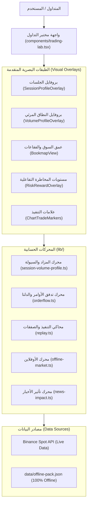

# 📊 Trading Lab & Order Flow Platform
### منصة مختبر التداول المؤسسي وتدفق الأوامر ومحاكاة الأسواق المالية

[اختبارات المشروع](tests/)
[](tsconfig.json)
[](app/)

---

## 🌟 نظرة عامة (Overview)

**منصة مختبر التداول (Trading Lab & Order Flow)** هي استوديو تداول ومحاكاة مؤسسي متكامل مبني بتقنيات الويب الحديثة (Next.js / TypeScript / TradingView Lightweight Charts). صُممت المنصة لتوفير أدوات متقدمة لا تتيحها منصات التجزئة التقليدية، مع التركيز على **تدفق الأوامر (Order Flow)**، و**بروفايل سيولة الجلسات (Session Volume Profile)**، و**عمق السوق (Bookmap Heatmap)**، و**إدارة المخاطر الاحترافية**.

تمتاز المنصة بأنها:
1. **منظومة مستقلة ومحمولة بالكامل:** يمكن تشغيلها سحابياً أو محلياً بنقرة زر واحدة عبر `run.bat` دون الحاجة لأي إعدادات معقدة.
2. **محاكاة شموع تاريخية:** محرك يتقدم بالشموع المكتملة؛ بيانات الدقيقة لا تثبت تسلسل الصفقات داخل الدقيقة.
3. **دعم العمل الكامل بدون اتصال بالإنترنت (100% Offline Mode):** حزمة بيانات تاريخية مدمجة لـ 4 أصول رئيسية عبر 6 أطر زمنية.
4. **كود معياري نظيف قابل لإعادة الاستخدام (Modular & Reusable):** يمكن اقتباس أي محرك حسابي أو مكون بصري واستخدامه في مشاريع أخرى بسهولة.

---

## 🏛️ البنية الهندسية للنظام (Architecture)



---

## 🛠️ دليل الأدوات والمؤشرات والعلامات البصرية (Tools & Markers Catalog)

### 1. بروفايل سيولة الجلسات (Session Volume Profile - SVP)
* **الملفات:** [`lib/session-volume-profile.ts`](lib/session-volume-profile.ts) | [`components/session-profile-overlay.tsx`](components/session-profile-overlay.tsx)
* **المفهوم:** تقسيم حركة السعر لكل جلسة تداول إلى بروفايل أفقي يوضح مستويات الأسعار التي تم عندها تبادل أكبر حجم تداول حقيقي.
* **المكونات الدقيقة:**
  - **خط التحكم السعري (POC - Point of Control):** السعر الأكثر تداولاً في الجلسة (مرسوم بخط أرجواني بارز `#d946ef`).
  - **منطقة القيمة (Value Area 70%):** النطاق السعري الذي استوعب 70% من إجمالي السيولة (بين VAH و VAL بلون عنبري ذهبي `#f59e0b`).
  - **ذيول الرفض والاستكشاف (Tails):** المناطق ذات الحجم المنخفض خارج منطقة القيمة (بلون رمادي رصين `#64748b`).
* **ميزة التجميع الذكي على الفريم اليومي (1D Auto-Grouping):**
  - لحل مشكلة تكدس البروفايل على الفريم اليومي (`1d`)، يقوم المحرك تلقائياً بتجميع الشموع اليومية في **جلسات أسبوعية متتابعة** (أو شهرية حسب الاختيار)، مما يعطي كل جلسة مساحة 5-7 شموع طبيعية تمنع أي تداخل وتتيح قراءة نماذج المزاد بارتياح.
* **أدوات التحكم في الشريط العلوي:**
  - `[ تلقائي | أسبوعي | شهري | يومي ]`: للتبديل الفوري بين نطاقات التجميع.
  - `[ + / − ]`: لتكبير أو تصغير عرض أشرطة البروفايل (من 60% وحتى 200%).
  - `[ ↔️ مساحة مريحة ]`: لتوسيع تباعد الشموع على الشارت (`barSpacing` حتى 32px) لإعطاء مساحة تنفس مريحة للعين.

---

### 2. بروفايل النطاق المرئي (Visible Range Volume Profile - VPVR)
* **الملفات:** [`lib/volume-profile.ts`](lib/volume-profile.ts) | [`components/volume-profile-overlay.tsx`](components/volume-profile-overlay.tsx)
* **المفهوم:** مسح كامل الشموع الظاهرة على الشاشة وحساب التوزيع التراكمي للسيولة مع فصل دقيق بين أحجام الشراء وأحجام البيع.
* **الخوارزمية:** تطبيق خوارزمية التوسع الثنائي لستيدلماير (Steidlmayer Dual Expansion Algorithm) مع اكتشاف العقد ذات السيولة العالية (HVN) والعقد ذات السيولة المنخفضة (LVN).

---

### 3. تدفق الأوامر ومصائد السيولة (Order Flow & Footprint Engine)
* **الملف:** [`lib/orderflow.ts`](lib/orderflow.ts)
* **المكونات:**
  - **دلتا الشمعة (Candle Delta):** احتساب تفوق المشترين المبادرين على البائعين ($BuyVolume - SellVolume$).
  - **الدلتا التراكمية (CVD - Cumulative Volume Delta):** كشف الانفراجات الخفية (Divergences) بين اتجاه السعر وتدفق الأحجام الحقيقية.
  - **تصنيف نماذج البروفايل التلقائي:**
    - `D_SHAPE`: توزيع متوازن (سوق مستقر داخل القيمة).
    - `P_SHAPE`: تغطية صفقات بيع وصعود حاد يتركز حجمه في النصف العلوي.
    - `B_SHAPE`: تسييل صفقات شراء وهبوط يتركز حجمه في النصف السفلي.
    - `THIN_TREND`: حركة اتجاهية سريعة خالية من السيولة.
  - **كشف صفقات الحيتان والامتصاص (Big Trades & Absorption):** رصد الشموع التي تجاوز حجمها 2.2 ضعف المتوسط مع وجود ذيل امتصاص (> 40%) وتحديد المشترين المحاصرين (Trapped Buyers) أو البائعين المحاصرين (Trapped Sellers).

---

### 4. منصة بوك ماب وعمق السوق (Bookmap Heatmap)
* **الملف:** [`components/bookmap-view.tsx`](components/bookmap-view.tsx)
* **المفهوم:** تحويل شارت الشموع إلى منصة عمق سوق لحظية مستوحاة من Bookmap:
  - **الخريطة الحرارية (Liquidity Heatmap):** تدرج لوني يوضح كتل الأوامر المعلقة في سجل الأوامر (Limit Orders).
  - **فقاعات الصفقات السوقية (Trade Bubbles):** فقاعات شراء خضراء وفقاعات بيع حمراء بحجم يتناسب طردياً مع السيولة المنفذة في تلك اللحظة.

---

### 5. إدارة المخاطر والتنفيذ المؤسسي (Risk-Reward & Execution)
* **الملفات:** [`lib/replay.ts`](lib/replay.ts) | [`components/risk-reward-overlay.tsx`](components/risk-reward-overlay.tsx) | [`components/stop-level-editor.tsx`](components/stop-level-editor.tsx)
* **المكونات:**
  - **مستويات سحب الأوامر التفاعلية:** خط دخول، ووقف خسارة، وهدف أرباح قابلة للسحب المباشر بالماوس مع حساب تلقائي للانزلاق والرسوم ونسبة المخاطرة للعائد ($R$).
  - **قاعدة الأمان في الدقيقة الملتبسة (Stop before Target):** إذا لمست شمعة واحدة كلاً من الهدف والوقف، ينفذ الوقف دائماً لحماية المتداول من النتائج المضللة.
  - **نظام التبريد والأهداف الجزئية (Scale-In & Multiple Partial TPs):** إمكانية تعزيز الصفقات الرابحة وتحديد حتى 5 مستويات جني أرباح جزئية، ونقل الوقف تلقائياً لنقطة الدخول (Breakeven).

---

### 6. علامات الشارت والرموز البصرية (Chart Markers & Badges)
* **الملفات:** [`components/chart-trade-markers.tsx`](components/chart-trade-markers.tsx) | [`components/chart-drawings.tsx`](components/chart-drawings.tsx)
* **العلامات المدعومة:**
  - **شارات الدخول والخروج (Execution Badges):** أسهم خضراء للشراء (`▲`) وأسهم حمراء للبيع (`▼`) مع سعر الدخول بدقة.
  - **أدوات الرسم والتحليل الهندسي:** خطوط الاتجاه (Trendlines)، والدعوم والمقاومات، وتصحيحات فيبوناتشي، ونماذج الهارمونيك الكاملة (Harmonic Butterfly / XABCD Pattern)، ومسطرة قياس النسبة والنقاط، والقلم الحر (Freehand Pen).

---

### 7. محرك الأحداث الاقتصادية الكبرى (Macro News Engine)
* **الملفات:** [`lib/news-impact.ts`](lib/news-impact.ts) | [`components/macro-panel.tsx`](components/macro-panel.tsx)
* **المفهوم:** تقويم اقتصادي تاريخي مدمج يحسب التأثير الإحصائي الفعلي لأخبار التضخم (CPI / PPI)، وبيانات الوظائف (NFP)، وقرارات الفائدة الفيدرالية (FOMC) مع تنبيهات صوتية وبصرية قبل صدور الخبر على الشارت.

---

### 8. وضع الأوفلاين 100% وحزمة البيانات (Offline Pack)
* **الملفات:** [`lib/offline-market.ts`](lib/offline-market.ts) | [`data/offline-pack.json`](data/offline-pack.json)
* **التغطية:** حزمة بيانات مضغوطة ومشفرة بحجم 1.1MB فقط تعمل بكفاءة تامة دون اتصال بالإنترنت للأصول التالية:
  - 🪙 **الذهب:** `XAUTUSDT`
  - ₿ **البيتكوين:** `BTCUSDT`
  - Ξ **الإيثيريوم:** `ETHUSDT`
  - ◎ **السولانا:** `SOLUSDT`
  - الفريمات: `1m`, `5m`, `15m`, `1h`, `4h`, `1d`.

---

## 🚀 التشغيل السريع في 60 ثانية (Quick Start)

### المتطلبات الأساسية
- تثبيت [Node.js](https://nodejs.org/) (إصدار 18 أو 20 أو 22).

### خطوات التنزيل والتشغيل:

```bash
# 1. استنساخ المستودع من جيتهاب
git clone https://github.com/nejmaldeen/trading_order-flow.git
cd trading_order-flow

# 2. تثبيت الحزم والمكتبات (تُنفذ مرة واحدة فقط)
npm install

# 3. تشغيل المنصة:
# على ويندوز: يمكنك الضغط المزدوج على run.bat
# أو من سطر الأوامر:
npm run dev
```

ستفتح المنصة تلقائياً على متصفحك عبر الرابط:
👉 `http://localhost:5173`

---

## 🧪 التحقق والاختبارات البرمجية (Verification Suite)

تتضمن المنصة اختبارات للمحرك والمؤشرات ومزود البيانات. شغّلها للتحقق من نسختك:

```bash
# تشغيل جميع اختبارات الوحدة
npm test

# فحص سلامة وتطابق الأنواع البرمجية
npx tsc --noEmit

# التحقق من بناء الإنتاج
npm run build
```

---

## 🧩 دليل إعادة استخدام المكونات في مشاريع أخرى (Component Reusability)

تم بناء جميع وحدات النظام بصيغة دوال ومكونات نقية (Pure Modular Functions):

### 1. إعادة استخدام محرك بروفايل الجلسات (SVP):
```typescript
import { computeDailySessionProfiles } from "./lib/session-volume-profile";

// حساب البروفايل لأي قائمة شموع
const sessions = computeDailySessionProfiles(candles, 36, 0.70, "15m", "auto");
sessions.forEach(session => {
  console.log(session.label);                // مثال: أسبوع 12 أكتوبر - 18 أكتوبر
  console.log(session.profile.pocPrice);     // سعر الـ POC
  console.log(session.profile.vahPrice);     // الحد الأعلى لمنطقة القيمة VAH
  console.log(session.profile.valPrice);     // الحد الأدنى لمنطقة القيمة VAL
});
```

### 2. إعادة استخدام محرك تدفق الأوامر (Order Flow):
```typescript
import { estimateCandleDelta, calculateOrderFlowProfile } from "./lib/orderflow";

// حساب الدلتا لشمعة واحدة
const delta = estimateCandleDelta(candle);

// استخراج شكل البروفايل (P-Shape / b-Shape / D-Shape)
const profile = calculateOrderFlowProfile(candles);
console.log("حالة المزاد:", profile.condition); // VALUE_UP / VALUE_DOWN / VALUE_INSIDE
console.log("شكل البروفايل:", profile.shape);    // D_SHAPE / P_SHAPE / B_SHAPE
```

---

## 📄 الترخيص (License)
هذا المشروع متاح للاستخدام الخاص والتطوير المؤسسي. جميع الحقوق محفوظة لـ **Nejmaldeen**.


## الأسهم وAlpaca SIP

الأصول AAPL وNVDA وAMD وGOOGL تستخدم مسارًا واحدًا: Alpaca → الخادم → الشارت ومحرك Replay.
يطلب الخادم `feed=sip`, `timeframe=1Min`, `adjustment=raw`, `sort=asc`، ويستكمل الصفحات.
التغطية المطلوبة منذ 2016، وتُفحص فعليًا عند التحميل. آخر 16 دقيقة مستبعدة؛ زر أحدث شمعة يختار دقيقة RTH مكتملة متاحة، وليس سعرًا حيًا.
تقويم Alpaca مع `America/New_York` يحدد RTH والعطلات والإغلاق المبكر وDST. تجمع الفريمات من افتتاح الجلسة؛ آخر ساعة/4 ساعات قد تكون أقصر عند الإغلاق.

المفاتيح على الخادم فقط: `ALPACA_API_KEY` و`ALPACA_API_SECRET` لحساب Paper مؤهل لـSIP. ضعها في أسرار الاستضافة؛ محليًا يستخدم Wrangler ملف `.dev.vars` المتجاهل في Git. لا ترفع الملف الخاص أو أي قيم سرية.
لا يرسل التطبيق أوامر تداول إلى Alpaca؛ يستخدم GET للشموع والتقويم فقط.
ذاكرة التخزين المؤقت محدودة إلى 12 كتلة أسبوعية لخمس دقائق، وتُعاد الطلبات بعد إعادة التشغيل. لا توجد قاعدة أسعار أو أرشيف أسهم جديد.

كل دقيقة متوقعة داخل RTH يجب أن تكون موجودة وصحيحة. إذا غابت دقيقة، يتوقف الطلب دون تقدم أو حفظ جزئي؛ لا نملأها اصطناعيًا. قد يعود الغياب لتعليق تداول أو قواعد أهلية الصفقات لدى المزود، ولا نستطيع حسم السبب من Bars وحدها. خارج RTH تقفز المحاكاة إلى الجلسة التالية.
قيم `raw` غير معدلة للتجزئة أو التوزيعات. محاكاة الاحتفاظ بصفقة عبر إجراء شركة ليست مدعومة؛ استخدم جلسات لا تعبر هذه الأحداث.
ترخيص إعادة التوزيع أو الاحتفاظ طويل المدى غير مثبت هنا؛ لا يُنشأ أرشيف دائم، ولا تعني صلاحية API منح ترخيص إضافي.

### سياسة التنفيذ والحفظ

الجلسات الجديدة موسومة بالمحرك v2؛ الإغلاق اليدوي والتعزيز ينفذان عند افتتاح الدقيقة التالية. عند غموض الوقف والهدف تُطبق أولوية الخسارة المحافظة مع حدث مسجل، ولا تمنح أرباحًا لدخول داخل الدقيقة نفسها. الأهداف الجزئية لا تتقدم على الوقف.
الانزلاق 0.02% والرسوم 0.15% لكل جهة افتراضات تدريب، وليست رسوم Alpaca. OHLCV وOrder Flow التقديري لا يثبتان تنفيذًا حقيقيًا أو ترتيب Tick-by-Tick.
الجلسات القديمة لا يعاد حسابها. جلسات الأسهم القديمة للقراءة فقط بعد إزالة المصدر الاصطناعي. الحزمة القديمة وسكربت الاستيراد حُفظا خارج المشروع قبل إزالتهما من المسار الفعال؛ بيانات الكريبتو لم تتغير. PAXG يبقى مصدرًا محليًا قديمًا، ولا يُعتمد كمصدر SIP موثق؛ الشموع غير الصالحة تُرفض.
الرصيد المشترك وحدة محاكاة اسمية؛ لا يوجد تحويل عملات USD/USDT أو محاسبة FX فعلية.

حفظ الجلسات يستخدم Cloudflare D1 باسم `DB` على Sites، أو Turso على Vercel عبر `TURSO_DATABASE_URL` و`TURSO_AUTH_TOKEN`. Turso يحفظ جدول الجلسات الموجود فقط؛ لا يخزن أسعار الأسهم. تهيئة الجدول آمنة ومتكررة ولا تمسح البيانات. عند غياب التخزين يرفض الخادم الحفظ بدل استخدام ذاكرة مؤقتة.
على Vercel يلزم `TRADING_LAB_PASSWORD` كسر من 20 إلى 200 حرف؛ استخدم كلمة عشوائية قوية. الدخول شخصي بحساب واحد، وملف ارتباط موقّع لمدة 24 ساعة، HttpOnly وSameSite=Strict وSecure عبر HTTPS. تغيير كلمة الدخول يبطل الجلسات القديمة. تحديد محاولات الدخول محلي لكل نسخة خادم وليس حدًا موزعًا؛ لا تستخدم كلمة ضعيفة أو تعِد استخدام كلمة حسابك الأساسي.
ترويسة هوية Sites لا تُقبل على Vercel. على Sites يستمر الاعتماد على بوابة الهوية الموثوقة. تبقى جلسات الجهاز المحلية مستقلة؛ لا تنقل إلى قاعدة السحابة تلقائيًا. يفضل فصل قاعدة معاينة الاختبارات عن قاعدة الإنتاج. أرشيف الأخبار المضمّن يبقى متاحًا على Vercel؛ تحديث أرشيف الأخبار الدائم عبر D1 خاص ببيئة Cloudflare.
مسار البناء على Vercel هو `.next`، ومحليًا `.next-production` لتفادي تعارض مخرجات Next/Vinext.

```sh
npm test
npx tsc --noEmit --incremental false
npm run build             # تحقق بناء Next.js
npm run build:cloudflare  # حزمة التشغيل الحالية لـ Sites/Cloudflare
```

الاختبارات المعزولة تستخدم بيانات وهمية معلنة لحالات الفشل. التحقق الحي من Alpaca منفصل، ولا يعني نجاحه صحة كل أسعار السوق أو واقعية كل تنفيذ.


### تحقق التكامل المعزول (26 أكتوبر 2026)

نجحت الأسهم الأربعة في API المحلي المبني للإنتاج عند 19 أغسطس 2026: تحميل 500 شمعة عرض لكل سهم، ثم تقدم 15 دقيقة من 13:30 إلى 13:44:59.999 UTC. زمن بدء فريم 1m البارد 4.3–5.4 ثوانٍ في هذه العينة؛ خطوات 15 دقيقة من الذاكرة 18–115 مللي ثانية (ليست ضمانًا للأداء السحابي).
نجحت دورة GOOGL: أمر معلق، دخول، تعزيز، إغلاق مؤجل، مع قراءة الحالة المحفوظة ورفض تعارض المراجعة HTTP 409.
نجح AAPL من 4 سبتمبر إلى 8 سبتمبر 2026 (Labor Day)، ومن 28 نوفمبر إلى 1 ديسمبر 2025 (إغلاق مبكر)، ومن 6 إلى 9 مارس 2026 (DST). نجحت قراءة جلسات QA بعد إعادة تشغيل العامل. نجحت بداية وخطوة Offline للأصول BTC/ETH/SOL/XAUT عبر API.
اختبار حي قابل لإعادة التنفيذ، يتطلب قاعدة D1 اختبار منفصلة؛ لا تشغله على قاعدة جلسات المستخدم:

```powershell
$env:QA_LAB_URL='http://127.0.0.1:5180'
$env:QA_ISOLATED_DB='yes'
node --test tests/live-equity-api.test.mjs
```

هذا تحقق محلي مع Alpaca الحقيقي، وليس إثباتًا لنجاح نشر Vercel. ضبط الأسرار والهوية والتخزين والتحقق من التطبيق المنشور خطوات مستقلة.
